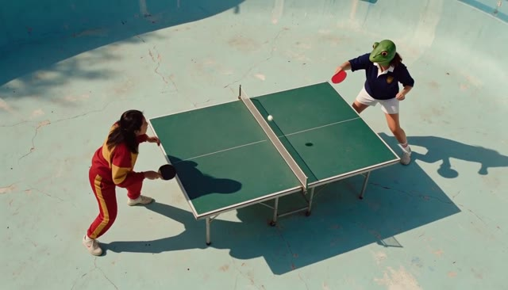
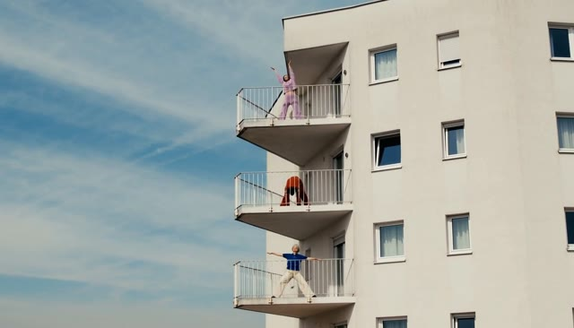
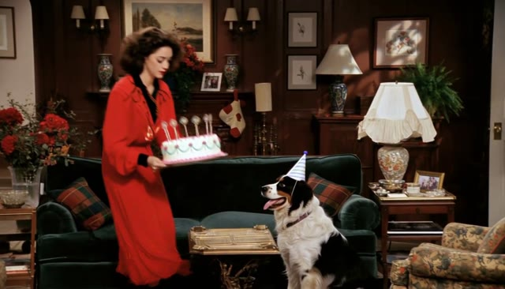
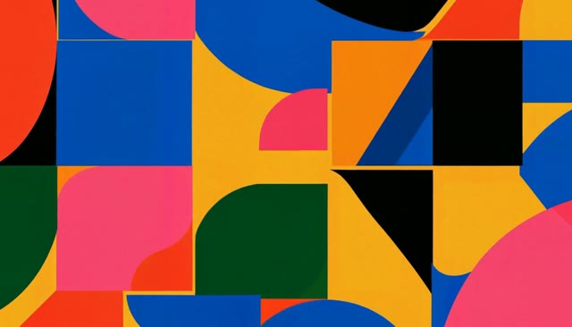
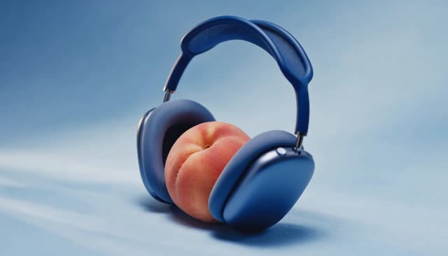
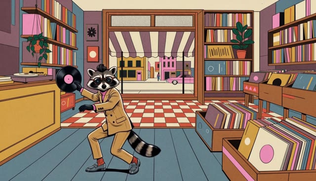

# Pika H3 Flex — creative showcases

[← Back to the README](../README.md)

Pika H3 Flex is a post-trained H3 video-and-audio model built for professional iteration. It gives creators a stronger starting point and more control as they refine a shot: direct camera movement, build multi-shot sequences, and guide characters, products, motion and sound with text, endpoint frames and multimodal references.

<table>
<tr>
<td align="center" width="50%"><a href="https://huggingface.co/Pika-Labs/Pika-H3-Flex/resolve/main/assets/showcases/camera-rally.mp4"></a><br /><strong>Frog table-tennis rally</strong><br />Camera choreography<br /><a href="https://huggingface.co/Pika-Labs/Pika-H3-Flex/resolve/main/assets/showcases/camera-rally.mp4">▶ Watch with audio</a></td>
<td align="center" width="50%"><a href="https://huggingface.co/Pika-Labs/Pika-H3-Flex/resolve/main/assets/showcases/balcony-orbit.mp4"></a><br /><strong>A journey between balconies</strong><br />Text-to-video camera control<br /><a href="https://huggingface.co/Pika-Labs/Pika-H3-Flex/resolve/main/assets/showcases/balcony-orbit.mp4">▶ Watch with audio</a></td>
</tr>
<tr>
<td align="center" width="50%"><a href="https://huggingface.co/Pika-Labs/Pika-H3-Flex/resolve/main/assets/showcases/sitcom-story.mp4"></a><br /><strong>The birthday-cake heist</strong><br />Multi-shot storytelling<br /><a href="https://huggingface.co/Pika-Labs/Pika-H3-Flex/resolve/main/assets/showcases/sitcom-story.mp4">▶ Watch with audio</a></td>
<td align="center" width="50%"><a href="https://huggingface.co/Pika-Labs/Pika-H3-Flex/resolve/main/assets/showcases/motion-graphics.mp4"></a><br /><strong>MOVE: kinetic typography</strong><br />Motion graphics<br /><a href="https://huggingface.co/Pika-Labs/Pika-H3-Flex/resolve/main/assets/showcases/motion-graphics.mp4">▶ Watch with audio</a></td>
</tr>
<tr>
<td align="center" width="50%"><a href="https://huggingface.co/Pika-Labs/Pika-H3-Flex/resolve/main/assets/showcases/product-film.mp4"></a><br /><strong>Feel the bass</strong><br />Product films<br /><a href="https://huggingface.co/Pika-Labs/Pika-H3-Flex/resolve/main/assets/showcases/product-film.mp4">▶ Watch with audio</a></td>
<td align="center" width="50%"><a href="https://huggingface.co/Pika-Labs/Pika-H3-Flex/resolve/main/assets/showcases/motion-transfer.mp4"></a><br /><strong>Record-shop dance</strong><br />Reference-guided motion<br /><a href="https://huggingface.co/Pika-Labs/Pika-H3-Flex/resolve/main/assets/showcases/motion-transfer.mp4">▶ Watch with audio</a></td>
</tr>
</table>

Each example below includes the supplied prompt and available input assets. These examples illustrate creative capabilities; their seeds, exact checkpoint revisions and service preprocessing are unspecified. They are not release-validation renders, and exact reproduction with this package is not guaranteed. The prompts express creative intent rather than guarantees of exact motion, typography or identity preservation. For local generation, adapt the supplied prompts using the [prompt guide](prompt-guidance.md) and preserve reference order.

## Frog table-tennis rally

Camera choreography. [Watch with audio](https://huggingface.co/Pika-Labs/Pika-H3-Flex/resolve/main/assets/showcases/camera-rally.mp4) · [Download prompt](https://huggingface.co/Pika-Labs/Pika-H3-Flex/resolve/main/assets/showcases/camera-rally.txt)

Inputs: [Image 1](https://huggingface.co/Pika-Labs/Pika-H3-Flex/resolve/main/assets/showcases/camera-rally-input-1.png)

<details>
<summary>Prompt</summary>

```text
Image 1 is the exact two players, outfits, frog mask, table-tennis table and drained pool: keep them exactly as in Image 1.
A fast table-tennis rally, shot with exactly these camera moves:
00:00–00:03 — top-down from directly overhead, as in Image 1, as the rally begins and the ball flicks back and forth.
00:03–00:06 — a smooth crane straight down from overhead to table height, ending right beside the net as the ball zips across.
00:06–00:09 — fast whip pans left and right following the ball across the net, from one player to the other.
00:09–00:12 — a 180-degree orbit around the frog-masked player as she leaps and smashes the ball.
00:12–00:15 — a low-angle dolly backward along the pool floor as the woman in the red tracksuit dives and misses; the frog raises both arms and does a little victory dance; the camera settles and holds.
The players, table and pool stay consistent and in the same place throughout. Photoreal 35mm film look, true colour, light natural grain, matching Image 1. SPEED IS CRITICAL: everything moves at normal real-time speed, like 24fps footage played back at 24fps - natural motion, NO slow motion.
Sound: the quick tock-tock of the ball, sneakers squeaking on concrete, the smash, a thud as she dives, echo in the empty pool, the frog's muffled cheer. Music: a funky, upbeat drum-and-bass groove.
```

</details>

## A journey between balconies

Text-to-video camera control. [Watch with audio](https://huggingface.co/Pika-Labs/Pika-H3-Flex/resolve/main/assets/showcases/balcony-orbit.mp4) · [Download prompt](https://huggingface.co/Pika-Labs/Pika-H3-Flex/resolve/main/assets/showcases/balcony-orbit.txt)

Text-only example; no input media.

<details>
<summary>Prompt</summary>

```text
A tall white modernist apartment tower against a soft pale-blue sky with faint streaky cirrus cloud. The building sits on the right half of the frame; the left half is open sky. Smooth off-white render facade with small square windows in thick white frames. Three identical cantilevered concrete balconies are stacked vertically on the building's corner, each a thick white slab with an angled, wedge-shaped underside and a thin white metal railing of vertical balusters. Crisp, graphic, minimal, soft 1970s film palette: chalky whites, powder blue, muted pastels.

Three people are doing a slow, calm morning stretch routine, one per balcony. They are always gently in motion, never frozen, but every movement is slow, smooth and controlled, like yoga or tai chi: each stretch takes three to four seconds to flow into, eases gently at the end, and flows unhurried into the next. No fast, jerky, snapping or flailing movements. Graceful, deliberate, meditative.
Top balcony: a young woman with dark hair pulled back, in a lilac fluffy knit jumper and matching lilac wide-leg knit trousers. She slowly reaches both arms high overhead, then gradually leans her upper body into a long side bend to the left, eases back to centre, and slowly leans to the right.
Middle balcony: a man with short dark hair in a rust-red tracksuit. He hangs in a deep forward fold with palms on the floor, then slowly rolls up through his spine to standing, and lifts his arms in one wide, slow circle overhead.
Bottom balcony: an older woman with short silver-grey hair in a cobalt blue short-sleeved polo and loose cream trousers. She holds a wide warrior lunge with arms stretched out to each side, slowly shifts her weight from one bent knee to the other, and gently sweeps one arm up and over her head into a side bend.
Each person moves at their own unhurried rhythm, slightly out of sync with each other, with full-body range of motion: knitwear and trousers stretching and settling, real balance and weight.

Camera, one continuous shot with no cuts:
0-3s: Wide establishing frame. The camera begins a slow, smooth orbit around the corner of the tower, arcing about 40 degrees, with strong parallax between the balconies, building face and sky.
3-5s: Still moving, the camera pushes in hard on the middle balcony until the man in the red tracksuit fills the frame alone, waist-up, mid-stretch, railing in the foreground.
5-7s: A steady vertical boom up the face of the building, past the concrete underside of the slab above, revealing the lilac woman mid-side-bend.
7-10s: A fast, controlled boom straight down past the middle balcony to the bottom one, revealing the older woman shifting through her lunge.
10-13s: Smooth pull back and reverse orbit, landing on the opening wide composition, all three still actively stretching.

Soft diffused daylight, gentle soft shadows under each slab, no hard sun. 35mm film look with fine grain. Stabilized crane/drone motion, never jittery.

Sound: natural diegetic location sound only — light wind gusting past the building, distant city hum, faint birds, soft fabric rustle. No music, no score, no singing, no melody, no rhythm track. No speech, no voices, no talking, no dialogue, no murmuring, no vocal sounds of any kind.
```

</details>

## The birthday-cake heist

Multi-shot storytelling. [Watch with audio](https://huggingface.co/Pika-Labs/Pika-H3-Flex/resolve/main/assets/showcases/sitcom-story.mp4) · [Download prompt](https://huggingface.co/Pika-Labs/Pika-H3-Flex/resolve/main/assets/showcases/sitcom-story.txt)

Inputs: [Image 1](https://huggingface.co/Pika-Labs/Pika-H3-Flex/resolve/main/assets/showcases/sitcom-story-input-1.png)

<details>
<summary>Prompt</summary>

```text
A 1990s American multi-camera sitcom scene exactly like Image 1: bright, flat studio lighting on a living-room set, slight videotape softness, the same woman in red. A live studio audience laughs throughout. Hard cuts between different camera angles.
[Shot 1] 0-3 s: wide shot. She carries a pretty birthday cake into the living room and sets it on the coffee table; a small dog in a party hat sits by the sofa, staring at the cake. (Audience: "Aww.")
[Shot 2] 3-5 s: medium shot. A sudden knock at the door. She points at the dog: "Wait here. Don't touch it." and walks out of frame to answer the door.
[Shot 3] 5-9 s: close-up, locked on the coffee table: the dog jumps up and wolfs down the cake, cream flying, party hat askew, tail wagging wildly. (Audience bursts out laughing.)
[Shot 4] 9-12 s: wide shot. She comes back and freezes: only a small piece of cake is left, the dog has cream all over its face and sits back down as if nothing happened, licking its lips. She throws her hands up, baffled: "…What happened?!"
[Shot 5] 12-15 s: close-up. The dog lets out a creamy little burp and tilts its head at her. She looks at the camera and sighs. (Big laugh and applause, sitcom transition music.)
Sound: studio audience laughter and applause, a knock, the dog gobbling and a tiny burp, an upbeat 90s sitcom theme. Only these two lines. No subtitles or other text.
```

</details>

## MOVE: kinetic typography

Motion graphics. [Watch with audio](https://huggingface.co/Pika-Labs/Pika-H3-Flex/resolve/main/assets/showcases/motion-graphics.mp4) · [Download prompt](https://huggingface.co/Pika-Labs/Pika-H3-Flex/resolve/main/assets/showcases/motion-graphics.txt)

Inputs: [Image 1](https://huggingface.co/Pika-Labs/Pika-H3-Flex/resolve/main/assets/showcases/motion-graphics-input-1.png)

<details>
<summary>Prompt</summary>

```text
A bold full-bleed motion graphic, NO frame, NO border, NO paper edges — the design fills the whole 16:9 screen. Flat Swiss/geometric style, exact colours and shapes of Image 1, crisp edges. BIG motion, never static, beat-synced to a punchy 120 BPM track.
0-3 s: the screen starts as one flat colour; geometric blocks slam in from all four sides on each beat, building the layout of Image 1.
3-7 s: circles roll across, triangles flip, stripes slide; a figure made of shapes runs through the composition, each step stamping a new colour block.
7-10 s: the letters of MOVE drop in one by one with heavy squash-and-stretch, then hold perfectly still; spell it exactly.
10-13 s: everything except MOVE explodes outward and snaps back on the beat, rearranged into a new layout.
13-15 s: fast camera push-in and a 15-degree rotation into the O of MOVE, ending on a solid colour.
Sound: punchy electronic beat with a hit on every shape. No other text.
```

</details>

## Feel the bass

Product films. [Watch with audio](https://huggingface.co/Pika-Labs/Pika-H3-Flex/resolve/main/assets/showcases/product-film.mp4) · [Download prompt](https://huggingface.co/Pika-Labs/Pika-H3-Flex/resolve/main/assets/showcases/product-film.txt)

Inputs: [Image 1](https://huggingface.co/Pika-Labs/Pika-H3-Flex/resolve/main/assets/showcases/product-film-input-1.png)

<details>
<summary>Prompt</summary>

```text
A 15-second fast-cut, high-energy cinematic product commercial for the cobalt-blue over-ear headphones from reference image 1 (exact same shape, colour, mesh headband, knit cushions and metal hinges, no logos) about deep bass. Edited like a premium tech launch film: rapid hard cuts on the beat, every shot a bold, different cinematic angle and lens. The film is about the HEADPHONES. NO glass, NO water, NO plants, NO other props. The whole film stays on a clean seamless powder-blue studio set; the background is always clean powder blue, never a wall edge or dark studio.
SHOT 1 (0-2.5s): OPENS on exactly the composition of reference image 1 — same framing and angle, the cobalt headphones holding the ripe peach between their ear cups on powder blue. The peach stays perfectly still and seated in place — it does NOT jump, bounce or move position — it only PULSES: its surface subtly swells and contracts like a heartbeat in time with each deep bass hit, the ear cups gently tightening with it. Slow push-in.
SHOT 2 (2.5-4s): Hard cut on the beat, the peach is gone for the rest of the film: snap-zoom extreme macro across the cobalt headband mesh, the fabric trembling with the bass.
SHOT 3 (4-5.5s): Extreme low worm's-eye angle, wide lens, looking up at the empty headphones towering against powder blue, fast dolly-in.
SHOT 4 (5.5-7s): Top-down overhead shot spinning slowly, the headphones laid open in a perfect graphic shape on powder blue.
SHOT 5 (7-8.5s): Dutch-angle macro sliding along the polished metal hinge and telescoping arm, light streaking across the metal.
SHOT 6 (8.5-10s): Rack focus from the soft knit ear cushion in the foreground to the second ear cup behind, shallow depth of field.
SHOT 7 (10-12s): Fast whip-pan into a low tracking shot as the headphones glide across the powder-blue floor toward camera, heavy motion blur, on the drop.
SHOT 8 (12-13.5s): Profile silhouette-style side angle, soft edge light outlining the curve of the headband, slow-motion.
SHOT 9 (13.5-15s): Crane down to the final hero shot of the empty headphones alone, three-quarter angle on powder blue, held on the last beat.
SOUND: a deep sub-bass heartbeat pulse building into a punchy, stylish minimal electronic track with hard hits on every cut and a big drop. LOOK: high-end cinematic beauty/tech commercial, editorial and refined, Jacquemus / Loewe campaign energy. Soft pale true-colour grounds against deep saturated hero colours, large soft diffused light, shadows soft but present, low-to-moderate contrast, creamy highlights, subtle 35mm film grain, shallow depth of field, anamorphic feel. CAMERA is always moving with bold confident motion — dollies, macro orbits, crane moves, motion blur on fast moves — never static. Product always tack-sharp and recognisable. Hard cuts between shots, each shot a different angle and scale, one clear story from start to end. Correct real-world physics. NO text, NO titles, NO captions, NO logos, NO subtitles anywhere. Audio: no voiceover, no dialogue, only a polished commercial soundtrack plus crisp tactile sound design.
```

</details>

## Record-shop dance

Reference-guided motion. [Watch with audio](https://huggingface.co/Pika-Labs/Pika-H3-Flex/resolve/main/assets/showcases/motion-transfer.mp4) · [Download prompt](https://huggingface.co/Pika-Labs/Pika-H3-Flex/resolve/main/assets/showcases/motion-transfer.txt)

Inputs: [Video 1](https://huggingface.co/Pika-Labs/Pika-H3-Flex/resolve/main/assets/showcases/motion-transfer-input-1.mp4) · [Image 1](https://huggingface.co/Pika-Labs/Pika-H3-Flex/resolve/main/assets/showcases/motion-transfer-input-2.png) · [Image 2](https://huggingface.co/Pika-Labs/Pika-H3-Flex/resolve/main/assets/showcases/motion-transfer-input-3.png)

<details>
<summary>Prompt</summary>

```text
References: @Image1 is the character sheet (front, three-quarter and back views of ONE character). @Image2 is the environment. @Video1 is the motion reference only. Make a new video of the character from @Image1, inside the environment from @Image2, performing exactly the body motion, choreography, timing and camera movement of the person in @Video1. Take NOTHING else from @Video1 - not the person's face, body, clothes, props, location, background, colours or photographic look. Keep the character exactly as designed in @Image1 - same face, proportions, outfit, colours - and render the whole video in the exact art style of @Image1 and @Image2, never photoreal. Only ONE character in frame. Style: vintage pop-art fashion illustration with black ink outlines, flat colour blocks, halftone and risograph grain, exactly as @Image1 and @Image2. Desmond dances on the terracotta checkerboard floor of his record shop from @Image2: the same whirling spins, flung arms and kicks as in @Video1, his mustard suit jacket flaring with each turn. Where the person in @Video1 holds the potted fern overhead, Desmond holds his vinyl record high above his head like a dance partner. He ends with arms wide and a little deadpan bow. Audio: an original upbeat 1960s-style soul groove playing from the turntable, loafers tapping and squeaking on the floor, a soft record-crackle. Normal real-time speed, NO slow motion. No text, no captions, no logos.
```

</details>

